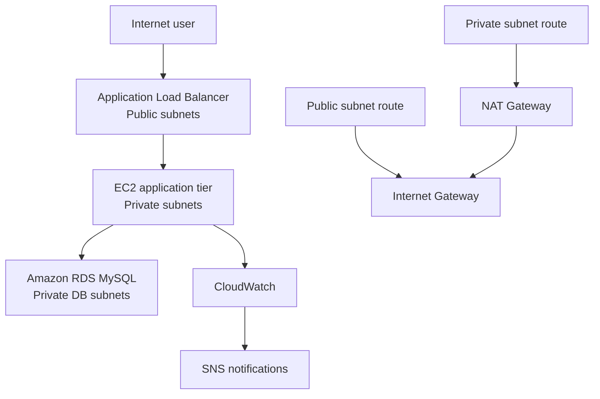

# AWS Three-Tier Web Application Architecture

A hands-on AWS project demonstrating a classic three-tier web application design using a custom VPC, public and private subnets, an Application Load Balancer, EC2 application instances, Amazon RDS for MySQL, Auto Scaling, IAM and CloudWatch/SNS.

## Project overview

The architecture separates the web entry point, application workload and database into distinct network tiers:

- **Presentation tier:** internet-facing Application Load Balancer in public subnets.
- **Application tier:** EC2-based web application in private subnets. The walkthrough installs Apache/PHP and deploys WordPress.
- **Data tier:** Amazon RDS MySQL in dedicated private database subnets.

The application is reached through the load balancer rather than by exposing the EC2 application instance directly.

## Architecture and network design

| Component | Configuration in this walkthrough |
|---|---|
| AWS VPC | `10.0.0.0/16` |
| Public subnet 1 | `10.0.1.0/24` |
| Public subnet 2 | `10.0.2.0/24` |
| Private application subnet 1 | `10.0.3.0/24` |
| Private application subnet 2 | `10.0.4.0/24` |
| Private database subnet 1 | `10.0.5.0/24` |
| Private database subnet 2 | `10.0.6.0/24` |
| Internet access | Internet Gateway for public subnets |
| Private outbound access | NAT Gateway and private route |
| Load balancing | Application Load Balancer and target group |
| Application compute | EC2, AMI and Auto Scaling Group |
| Database | Amazon RDS for MySQL |
| Operations | IAM instance role, CloudWatch and SNS |

### Traffic flow

### Security group intent

The security groups are intended to enforce tier-to-tier access:

| Security group | Inbound access |
|---|---|
| Load balancer | HTTP/HTTPS from approved client ranges |
| Application | Application HTTP traffic from the load balancer security group |
| Database | MySQL traffic from the application security group only |

For a real deployment, restrict public ingress to the required client ranges, use HTTPS with an appropriate certificate, and avoid opening SSH/RDP to the entire internet. Prefer Systems Manager Session Manager for administrative access where possible.

## Implementation walkthrough

1. **Create the VPC and subnets.** Create the VPC and separate public, private application and private database subnets across Availability Zones.
2. **Configure routing.** Attach an Internet Gateway, create public and private route tables, and route private-subnet outbound traffic through the NAT Gateway.
3. **Create security groups.** Allow client traffic to the load balancer, load-balancer-to-application traffic, and application-to-database traffic. Keep the database private.
4. **Create an IAM instance role.** The original walkthrough uses the `AmazonSSMManagedInstanceCore` policy for Systems Manager access.
5. **Launch the application instance.** Place the EC2 instance in a private application subnet and attach the application security group and IAM role.
6. **Install the web stack.** Install Apache, PHP and the required PHP/MySQL integration packages. Deploy WordPress application files to the web root.
7. **Create the database.** Create an RDS subnet group using the private database subnets, provision the MySQL database, and create the application database and credentials.
8. **Configure the application.** Add the RDS endpoint and database connection values to the WordPress configuration. Never commit real credentials to Git.
9. **Create an AMI and target group.** Capture the configured application instance as an AMI and register instances with a target group.
10. **Create the Application Load Balancer.** Place the ALB in the public subnets and configure its listener to forward to the application target group.
11. **Configure Auto Scaling.** Use the application AMI and target group to define the Auto Scaling Group and its capacity settings.
12. **Add monitoring and notifications.** Configure CloudWatch monitoring and SNS notifications for the selected events/alarms.

## Validation checklist

Use these checks when recreating the environment:

- [ ] VPC, subnet CIDRs and route-table associations match the design.
- [ ] Public load balancer is reachable on its configured listener.
- [ ] Application instances remain in private subnets.
- [ ] Target group reports healthy application targets.
- [ ] Application can connect to the private RDS database.
- [ ] Database is not directly reachable from the public internet.
- [ ] WordPress page loads through the ALB DNS name.
- [ ] Auto Scaling Group reports the intended desired capacity.
- [ ] CloudWatch alarms and SNS notifications are tested.

## Important design notes

- This repository documents a **console-based implementation walkthrough** with screenshots. It is not an automated Terraform deployment.
- The original design uses a single NAT Gateway. That is a cost-conscious learning setup, but it can introduce an Availability Zone dependency. A production design should assess per-AZ NAT Gateways, resilience, cost and egress controls.
- Configure TLS at the load balancer for real workloads.
- Use Secrets Manager or Systems Manager Parameter Store for database credentials rather than storing secrets in source code or AMIs.
- Review EC2/RDS sizing, backups, encryption, patching, logging and least-privilege IAM before using a similar design for production.
- The resource configuration and screenshots are an educational reference, not a claim of a currently running AWS environment.

## Technology stack

Amazon VPC · EC2 · Application Load Balancer · Auto Scaling · Amazon RDS (MySQL) · IAM · Systems Manager · CloudWatch · SNS · WordPress · Apache · PHP

## Screenshots

The screenshots below document the original console walkthrough. Expand a section to view the evidence.

01. Architecture overview

02. VPC and subnet configuration

03. Public and private subnet layout

04. Route table configuration

05. Internet Gateway

06. NAT Gateway

07. Public route to Internet Gateway

08. Private route through NAT Gateway

09. Security group rules

10. EC2 Systems Manager IAM role

11. Application EC2 instance

12. RDS subnet group – primary view

13. RDS subnet group – subnet selection

14. Database connection and setup

15. WordPress application files

16. WordPress database configuration

17. Application server AMI

18. Target group

19. Application Load Balancer configuration

20. Application response through load balancer

21. WordPress deployment verification

22. Application availability verification

23. Auto Scaling Group configuration

24. Auto Scaling Group capacity

25. SNS and CloudWatch configuration

26. Monitoring and notification configuration

## Author

[JOSH801251](https://github.com/JOSH801251)
